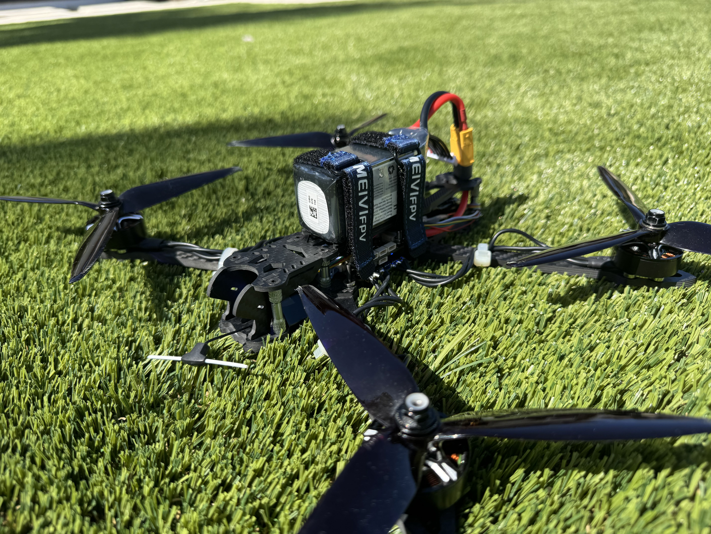
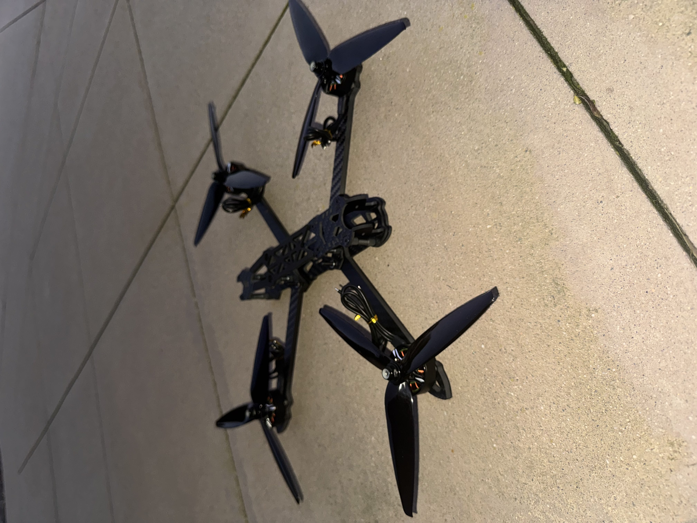
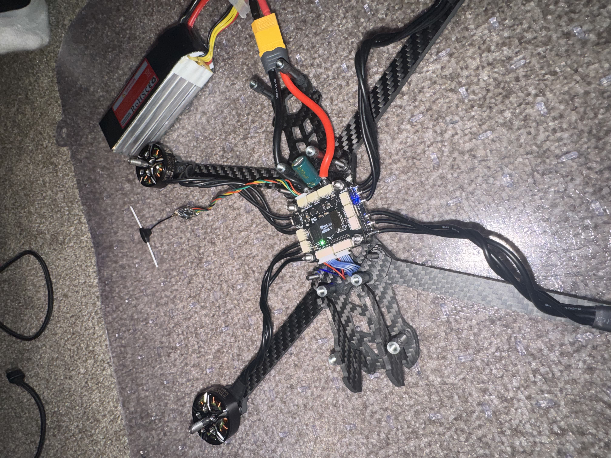
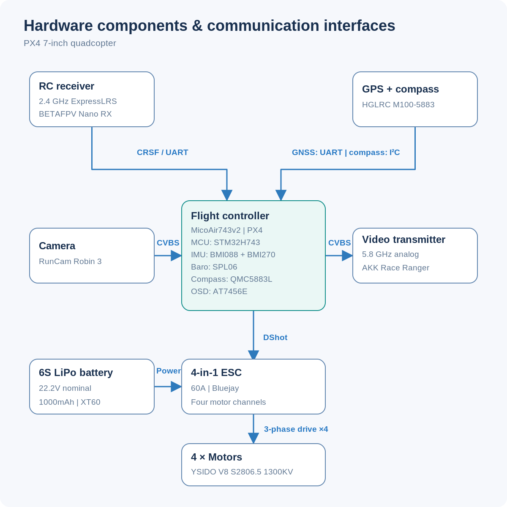
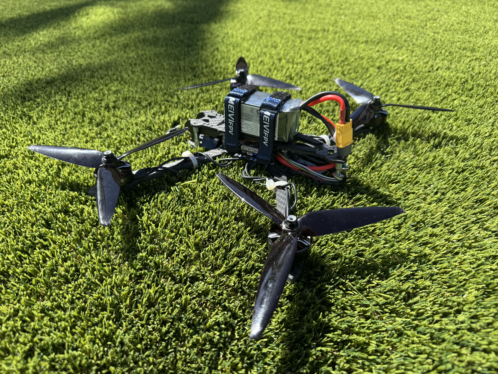
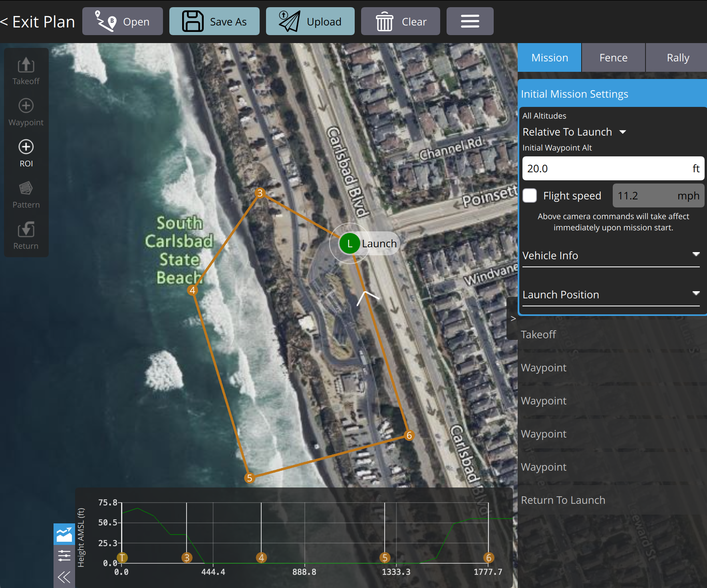

# PX4 Quadcopter

7-inch quadcopter running **PX4** on the **MicoAir743v2**, with **ExpressLRS** radio control and **GNSS** navigation hardware. Capable of manual, assisted, and fully-autonomous flight, supporting 10 different flight modes.

  <figure>
    

      <video controls playsinline preload="metadata" aria-label="Flight footage">
        <source src="assets/video/flight.mp4" type="video/mp4">
        Your browser does not support HTML5 video.
      </video>
    

  </figure>
  <figure>
    

      
    

  </figure>

## Airframe and propulsion

The **Mark4 carbon-fiber frame** carries **7-inch props** driven by four **YSIDO 2806.5 1300KV brushless motors**. The carbon fiber frame is lightweight, durable, and crash resistant, and the larger props favor efficient cruising at lower speeds. A **60A 4-in-1 ESC** running **Bluejay** firmware drives motors with **DShot**, with reduced wiring compared to four separate ESCs. A **6S 1000mAh LiPo** as a power source has adequate charge for approximately 10-15 minutes of flight. The small pack keeps weight down at the expense of flight time, and can be upgraded for longer trips. 

  <figure>
    

      
    

  </figure>
  <figure>
    

      
    

  </figure>

## Flight control and navigation

The **MicoAir743v2** flight controller runs PX4 on an **STM32H743** MCU. Onboard hardware includes **BMI088 and BMI270 IMUs**, **SPL06 barometer**, **QMC5883L compass**, **AT7456E OSD chip**, and a microSD slot for flight logs. A **BETAFPV Nano RX** receives **2.4 GHz ExpressLRS** radio commands and passes them to PX4 on **CRSF over UART**. ExpressLRS packet rates can be adjusted to trade lower latency against link sensitivity and range. The **HGLRC M100-5883** adds an **M10-generation, multi-constellation GNSS receiver** and external compass, connected to the FC using **UART** and **I²C**. These sensors provide the positioning and heading inputs needed for PX4's GPS-assisted and waypoint-navigation modes. The GPS module is positioned away from motors and power wiring to reduce interference, taking on average 20 seconds to 2 minutes to acquire a signal. 

<figure>
    

      
    

  </figure>
  <figure>
    

      
    

  </figure>

## Analog video

The selected video hardware is a **RunCam Robin 3** camera and an **AKK Race Ranger 5.8 GHz** analog video transmitter, utilizing a **3dBi RHCP antenna**. The connection passes through the flight controller, utilizing its onboard **AT7456E OSD chip** to overlay flight telemetry onto the video feed. Possible telemetry includes battery voltage, flight mode, altitude, GPS coordinates, ground speed, heading, and flight time.

## Autonomous Flight

PX4 supports autonomous waypoint navigation, position hold, and return-to-launch using the onboard sensors and GPS module. Missions are planned in **QGroundControl** by defining GPS waypoints, flight altitudes, and takeoff/landing commands. The flight plan is uploaded to the flight controller over **MAVLink** via the FC USB port, after which PX4 can execute the mission independently in Mission mode. Autonomous flight requires a valid GPS fix, calibrated sensors, and configured failsafes. 

  <figure>
    

      
    

  </figure>

